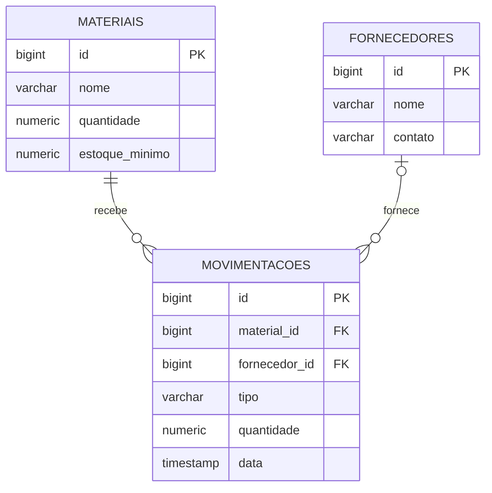

# Modelo de domínio

O domínio da aplicação representa o controle de matérias-primas de uma indústria. Há três entidades persistidas: `Material`, `Fornecedor` e `Movimentacao`. Os atributos abaixo foram conferidos nas classes Java e na migration SQL do projeto.

## Entidades

### Material (`materiais`)

Representa uma matéria-prima controlada pelo estoque.

| Atributo Java | Tipo Java | Coluna | Obrigatório | Regra / observação |
|---|---|---|---|---|
| `id` | `Long` | `id` | Sim | Chave primária gerada pelo banco |
| `nome` | `String` | `nome` | Sim | Nome do material; não pode ficar em branco na entrada da API |
| `quantidade` | `BigDecimal` | `quantidade` | Sim | Saldo atual, precisão 10 e escala 2; não pode ser negativo |
| `estoqueMinimo` | `BigDecimal` | `estoque_minimo` | Sim | Limite mínimo, precisão 10 e escala 2; não pode ser negativo |

### Fornecedor (`fornecedores`)

Representa uma empresa ou pessoa que fornece matéria-prima.

| Atributo Java | Tipo Java | Coluna | Obrigatório | Regra / observação |
|---|---|---|---|---|
| `id` | `Long` | `id` | Sim | Chave primária gerada pelo banco |
| `nome` | `String` | `nome` | Sim | Nome obrigatório na entrada da API |
| `contato` | `String` | `contato` | Não | Informação de contato opcional |

### Movimentacao (`movimentacoes`)

Registra uma entrada ou saída de uma matéria-prima e a quantidade movimentada.

| Atributo Java | Tipo Java | Coluna | Obrigatório | Regra / observação |
|---|---|---|---|---|
| `id` | `Long` | `id` | Sim | Chave primária gerada pelo banco |
| `material` | `Material` | `material_id` | Sim | Referência obrigatória a um material existente |
| `fornecedor` | `Fornecedor` | `fornecedor_id` | Não | Referência opcional a um fornecedor |
| `tipo` | `String` | `tipo` | Sim | Deve ser `entrada` ou `saida` |
| `quantidade` | `BigDecimal` | `quantidade` | Sim | Deve ser maior que zero; precisão 10 e escala 2 |
| `data` | `LocalDateTime` | `data` | Sim | Data e hora do registro; padrão no banco e na entidade |

## Relacionamentos

| De | Para | Cardinalidade | Implementação |
|---|---|---|---|
| `Movimentacao` | `Material` | Muitas movimentações para um material | `@ManyToOne(optional = false)`; `material_id` é chave estrangeira obrigatória |
| `Movimentacao` | `Fornecedor` | Muitas movimentações podem referenciar um fornecedor; fornecedor pode ser nulo | `@ManyToOne`; `fornecedor_id` é chave estrangeira opcional |

## Diagrama ER

A relação entre materiais e movimentações é obrigatória: uma movimentação pertence a um material. O fornecedor é opcional em uma movimentação.

## Migration

| Versão | Arquivo | Conteúdo |
|---|---|---|
| V1 | `src/main/resources/db/migration/V1__criar_tabelas_estoque.sql` | Cria as tabelas `fornecedores`, `materiais` e `movimentacoes`, suas chaves primárias e estrangeiras e restrições de quantidade/tipo. |

O Flyway aplica a migration na inicialização. O Hibernate está configurado para validar o esquema (`ddl-auto=validate`), não para criar as tabelas automaticamente.
